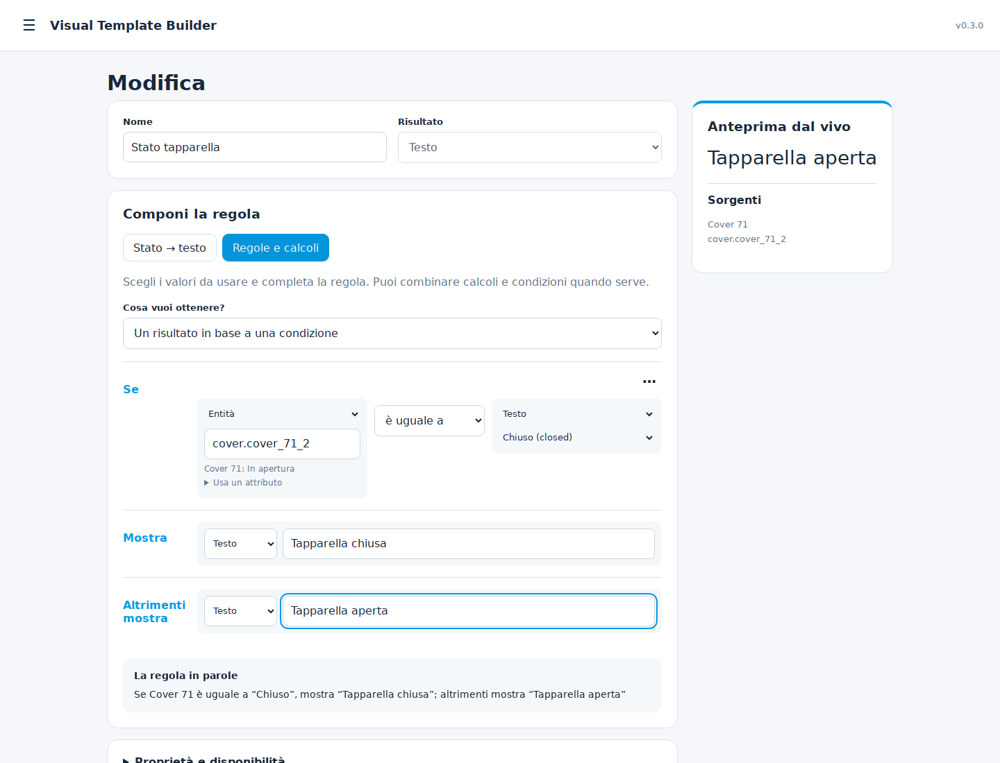
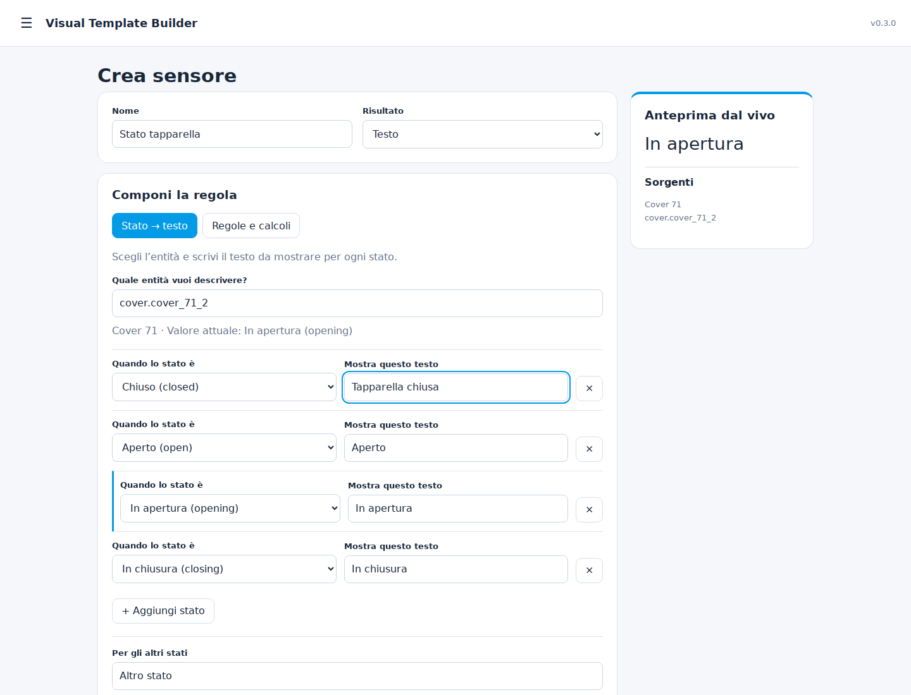

# Visual Template Builder

Build Home Assistant sensors visually, without writing YAML or Jinja.

**Version 0.3.0 — experimental release.** A custom integration with a sidebar editor for numeric, text and binary sensors. Runs entirely inside Home Assistant; no external service, cloud account, Node-RED or add-on is required.

## Installazione (Italiano)

1. In **HACS → menu ⋮ → Repository personalizzate**, aggiungi:
   `https://github.com/xtimmy86x/ha-visual-template-builder`, categoria **Integrazione**.
2. Cerca **Visual Template Builder** in HACS e scaricala.
3. Riavvia Home Assistant.
4. In **Impostazioni → Dispositivi e servizi → Aggiungi integrazione**, cerca **Visual Template Builder** e conferma.
5. Apri **Visual Template Builder** nella barra laterale con un account amministratore.

Per aggiornamenti successivi, aggiorna da HACS e riavvia Home Assistant. L’indirizzo del pannello include la versione e un’impronta del file, quindi il browser scarica sempre il codice aggiornato. Se il pannello era già aperto durante l’aggiornamento, compare l’avviso **Ricarica**.

### Crea il primo sensore

L'editor è diviso in tre passaggi numerati:

1. **Nome e tipo:** assegna un nome e scegli il risultato tra le schede **Numero**, **Testo** o **Acceso / spento**, ognuna con un esempio.
2. **Regola:** parti da un esempio rapido (es. *Converti unità (W → kW)*, *Sopra una soglia*) oppure scegli un'operazione. Ogni elemento può contenere un'entità, un valore fisso o un'altra operazione.
   Cerca le entità per nome o ID: l'elenco mostra nome, ID e valore attuale. In **Valore da leggere** scegli lo stato o uno degli attributi reali dell'entità.
3. **Opzioni avanzate:** unità, icona (con anteprima mentre scrivi e icone suggerite), classi e comportamento quando il calcolo fallisce. Con **Copia da …** riprendi unità e classi dalla sorgente.

- Controlla l'anteprima; su mobile il risultato resta visibile accanto a **Salva sensore**.
- Salva: l'entità viene aggiunta subito. Le modifiche alle regole non ricaricano l'integrazione.

### Editor generale: regole leggibili

L’editor generale ora propone controlli adatti al risultato scelto:

- **Calcoli:** scegli l’operazione, le entità e i numeri, con i segni matematici tra i valori.
- **Confronti:** una riga con valore di sinistra, confronto e valore di destra.
- **Condizioni:** componi frasi **Se… Mostra… Altrimenti mostra…**, anche con calcoli nei risultati.
- **Più condizioni:** scegli se devono essere vere tutte oppure almeno una, e aggiungi righe.
- **Testi e conteggi:** aggiungi solo i valori o le condizioni che ti servono.

Il selettore **Usa** cambia la sorgente di un valore (entità, numero, testo, ecc.). Le regole dentro altre regole (es. un calcolo tra parentesi) compaiono in un riquadro con bordo colorato, con il proprio **Usa** e la propria operazione. Gli attributi sono raccolti in **Usa un attributo**. **La regola in parole** riassume la logica con i nomi delle entità mentre la modifichi.

Le configurazioni precedenti vengono lette senza modificare le espressioni salvate. Il motore di calcolo e la gestione della disponibilità restano gli stessi.



### Associare lo stato di un’entità a un testo



Scegli la scheda **Testo** in **Nome e tipo**. La modalità **Stato → testo** si apre automaticamente:

1. Seleziona l’entità, ad esempio una tapparella.
2. Modifica il testo accanto a ciascuno stato: **Chiuso → Tapparella chiusa**, **Aperto → Tapparella aperta**, **In apertura → Si sta aprendo**, **In chiusura → Si sta chiudendo**.
3. Imposta il testo per eventuali altri stati e salva.

Le tapparelle propongono i quattro stati distinti; interruttori e sensori binari propongono acceso/spento. Per entità con opzioni vengono proposte le opzioni disponibili. Puoi aggiungere stati personalizzati, fino a 10 righe. Il testo per gli altri stati **non sostituisce** la gestione di `unknown`/`unavailable`, configurabile in **Opzioni avanzate**.

Le regole semplici già create nella 0.1.0 si aprono nella tabella mantenendo esattamente testi e caso “Altrimenti”. Le logiche più complesse restano nella vista **Regole e calcoli**. Il cambio di vista non modifica la regola salvata.

Esempi:

| Obiettivo | Regola visuale |
|---|---|
| Convertire W in kW | Divisione → Entità potenza / Valore fisso 1000 |
| Consumo senza garage | Sottrazione → Entità totale − Entità garage |
| Confrontare due misure | Uguali entro tolleranza → Entità A, Entità B, 0.1 |
| Macchina in produzione | Tutte vere (E) → potenza > 100, abilitazione = on |
| Testo di stato | Se allarme → “Allarme”; altrimenti un'altra regola Se/Allora/Altrimenti |
| Finestre aperte | Conta condizioni vere → entità binarie delle finestre |
| Testo con valore | Unisci testi e valori → “Potenza: ”, entità, “ W” |

**Tipo di risultato:** non è modificabile dopo il primo salvataggio. Duplica il sensore per crearne uno di un altro tipo.

## Features

- Numeric, text and binary entities with stable unique IDs.
- Guided **State → text** table with automatic state suggestions, existing-rule recognition and lossless switching to the general editor.
- Nested arithmetic: sum, subtraction, multiplication, division, mean, minimum, maximum, rounding, absolute value.
- Text equality/inequality; numeric greater/less comparisons and equality with tolerance.
- AND, OR, NOT and conditional branches; conditions short-circuit and only the selected branch is evaluated.
- Text concatenation and count of true conditions.
- State or scalar attribute sources; event-driven updates, including attribute-only changes.
- Live backend preview using the same evaluator as the entities.
- Italian/English UI, HA theme colors and responsive mobile layout.
- Add, edit, duplicate, delete and JSON export of definitions.
- Configurable unit, icon, device class and state class.
- Explicit unavailable/fallback/keep-last behavior; last value restoration for keep-last sensors.
- Persistent definitions in HA storage, optimistic edit conflict protection, circular-dependency rejection and admin-only API.

## Availability and types

The default behavior is **unavailable**, never silently substituting zero. Missing entities, `unknown`/`unavailable` states, missing attributes, invalid conversions and invalid arithmetic all use the selected policy:

| Policy | Behavior |
|---|---|
| Unavailable | Entity becomes unavailable until its expression evaluates successfully. |
| Fallback | Use a configured value of the selected result type. |
| Keep last | Retain the last successful value, including after restart when HA has a stored state. Before the first valid value, remain unavailable. |

Fallback/retained states expose `stale: true` and `evaluation_error` attributes. Healthy states expose `stale: false`. Home Assistant may omit custom attributes while an entity is unavailable. The preview reports the evaluation error; it does not substitute the live entity's retained value.

Boolean inputs accept `on/off`, `true/false`, `1/0` or actual booleans. Other strings need an explicit comparison. Equality preserves text such as article codes with leading zeroes: use **Equal within tolerance** for numeric equality across different representations. Text states are limited to 255 characters.

Classes/units are optional: select combinations appropriate to the measurement. State classes enable HA statistics; do not assign `total_increasing` to a measurement that can decrease normally. Display names and entity IDs can also be customized through HA's entity settings; such custom names override the integration's suggested name.

## Installation (English)

Requires **Home Assistant 2026.3 or newer**. Backend lifecycle tests currently run against **2026.3.4 / Python 3.14**; later HA releases still need real-installation validation.

Add this repository as a custom **Integration** in HACS, download it and restart Home Assistant. Then add **Visual Template Builder** through Settings → Devices & services → Add integration. The sidebar panel is available to administrators.

For manual installation, copy `custom_components/visual_template_builder` into your HA `config/custom_components` directory, restart, and add the integration.

HACS custom-repository installation is supported; this project is not yet in the default HACS catalog.

## Architecture and current boundaries

The visual editor stores a structured expression tree, evaluated locally by the integration. These are entities owned by **Visual Template Builder**, not native Template helper entries. No Python/Jinja code from the browser is executed. The browser preview and live entities share one backend evaluator.

- One integration entry, up to 200 sensors, 250 expression nodes and 12 levels per expression.
- Sources must exist as HA states or registered entities when first selected. Existing unavailable sources are supported. HA source-ID renames are not automatically rewritten in rules: update them in the editor.
- Visual-sensor dependencies are supported; direct/indirect cycles within this integration are rejected. External automations can still create feedback loops outside this integration's dependency graph.
- The editor runs on explicit entity selections; it does not yet support dynamic area/label selection.
- JSON **export** is included. Import, Jinja/YAML export, trigger-based sensors, delays/hysteresis and a per-condition truth inspector are planned, not implemented in 0.3.0.
- Deleting a sensor removes its definition and HA entity registry entry. Removing the integration removes its saved definitions; use HA backups to preserve configuration.

## Development

```sh
uv venv --python 3.14
uv pip install --python .venv/bin/python -r requirements-test.txt
.venv/bin/ruff check .
.venv/bin/ruff format --check .
.venv/bin/pytest -q
node --check custom_components/visual_template_builder/frontend/panel.js
npm ci
npx playwright install chromium
npm run test:panel
```

Python tests exercise calculations, real Home Assistant entity/state/registry/storage behavior, reloads, failure policies and access control. The browser test uses mocked HA WebSocket responses to verify editor interactions and mobile layout. No tests connect to or control a production HA instance.

MIT licensed.
